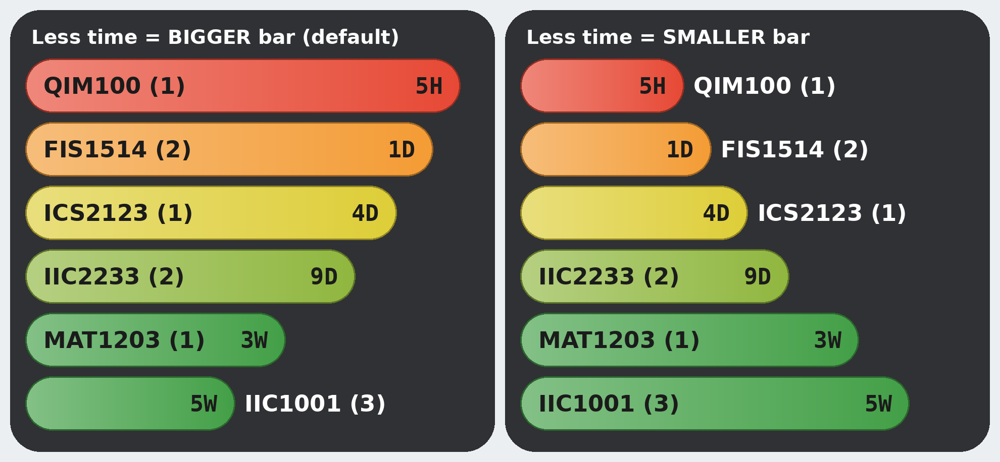

# Test Countdown Widget (Android)

A home-screen widget that shows your upcoming tests (interrogations) as a scrollable list of
bars: **course name**, **test number** and **time left**, for example `MAT1203 (1)  3W`.



*(Mock-up drawn from the same rules as the app. Left: light theme, less time = bigger bar. Right: dark theme, less time = smaller bar.)*

The look follows light launcher widgets (light grey card, the launcher's own corner radius, no header: just the bars, sized so whole rows fill the widget) and switches to a dark card in dark mode. The app is in English and Spanish.

## How it works

| Time left          | Label   | Color                               |
|--------------------|---------|-------------------------------------|
| 2 weeks or more    | `3W`    | green                               |
| 1 day to 2 weeks   | `9D`    | green → yellow gradient (2W to 2D)  |
| under 1 day        | `5H`    | yellow → red gradient (under 2D)    |

* `W` = weeks, `D` = days, `H` = hours (`<1H` in the last hour).
* **Bar width depends on the time left.** In the app you can choose:
  * **Less time left = bigger bar** (default): the closest test has the longest bar.
  * Turn it off for **less time left = smaller bar**: the bar shrinks as the test gets closer.
* **Bar scale**: how much time the full range of the bar covers (2–16 weeks, default 8).
  Tests further away than that use the end width. The scale is square-root based, so tests a
  few days or hours apart still look different.
* Tests are sorted closest first. Finished tests disappear from the widget automatically.
* The widget refreshes every 30 minutes (Android's minimum), when you edit tests, and when
  the clock or time zone changes.

## Using it

1. Open the **Test Countdown** app and tap **Add test**: course name (e.g. `MAT1203`), test
   number and date/time.
2. Tap a test to edit it, or long-press it to delete it. **Remove finished** clears old ones.
3. Long-press your home screen → *Widgets* → **Test countdown**, and place it. It can be resized,
   and the bars redraw to fit.

## Install (no Android Studio needed)

Download the latest `TestCountdown-vX.Y.Z.apk` from the
[Releases page](../../releases), open it on your phone, and allow
"install unknown apps" when Android asks. Requires Android 8.0+.

## Xiaomi / HyperOS tips

HyperOS limits apps in the background, which can stop the widget from refreshing on time:

1. Long-press the **Test Countdown** app icon → **App info**.
2. Turn on **Autostart**.
3. **Battery saver** → **No restrictions**.

To add the widget: long-press the home screen → **Widgets**, then scroll down to the list of
apps (or search "Test") and drag **Test countdown** onto the screen.

## Making a release

On GitHub: **Actions → Release APK → Run workflow**, type a new version (e.g. `v1.0.1`) and run it.
GitHub Actions tests, builds and publishes the APK as a Release. Or push a tag yourself:

```bash
git tag v1.0.1
git push origin v1.0.1
```

By default the APK is signed with a throwaway debug key, which changes every build, so you
have to uninstall the old version before installing a new one (your saved tests are lost).
To keep updates seamless, sign with your own key once:

1. `keytool -genkeypair -v -keystore release.jks -alias testcountdown -keyalg RSA -keysize 2048 -validity 10000`
2. In the repo on GitHub: *Settings → Secrets and variables → Actions*, add
   `RELEASE_KEYSTORE_BASE64` (output of `base64 -w0 release.jks`), `RELEASE_KEYSTORE_PASSWORD`,
   `RELEASE_KEY_ALIAS` (`testcountdown`) and `RELEASE_KEY_PASSWORD`.
3. Keep `release.jks` safe and never commit it.

## Building

Requirements: Android Studio (or JDK 17+ and the Android SDK, API 35).

```bash
./gradlew assembleDebug          # APK at app/build/outputs/apk/debug/app-debug.apk
./gradlew installDebug           # install on a connected device
./gradlew testDebugUnitTest      # unit tests for the time/color/width rules
```

Min Android version: 8.0 (API 26). No third-party libraries are used.

## Code map

| File | What it does |
|------|--------------|
| `Urgency.kt` | Time label (`3W/2D/3H`), color gradient rules, bar width |
| `PillRenderer.kt` | Draws one bar (bitmap) with the gradient and text |
| `ExamWidgetProvider.kt` | The widget itself (updates, clicks, resize) |
| `ExamWidgetService.kt` | Fills the widget's scrollable list |
| `ExamRepository.kt` | Saves tests and settings |
| `MainActivity.kt` | App screen: add/edit/delete tests, settings, live preview |
